# PR #332 evidence: LEARN.UX.P1 on-table teaching (#331), English V1

This is an evidence-only orphan branch. **Do not merge.** It shares no history with product branches. It exists because generated screenshots must not be committed to product branches.

## Build identity

| | Commit | Tree |
|---|---|---|
| BEFORE (PR #330 head) | `697f2d03193934790a23d7ba58996289bd51cae8` | `666f31856a0a177fa018c02b57ea64a0bda7d92a` |
| AFTER (native captures) | `6b1ec9ed366201479b019b6f5e007c5ed1baeaf3` | `9efb2982cdb2def699d8a0db549f231dde6465b6` |

- Device: iPhone 14 Pro reference simulator, iOS 26.2, 393×852 pt.
- Build: `flutter build ios --simulator --debug` (Flutter 3.35.7), with no dart-defines and default preview flags.
- Each build was installed fresh (uninstall, then install with empty data) and driven with real taps. No learner progress was seeded.
- Full provenance is in [`MANIFEST.txt`](MANIFEST.txt).

The PR #332 follow-up after `6b1ec9ed` changes only the presentation of answer-free recaps (World 4+, `KEY TAKEAWAY`). It does not touch any World 1 path shown here.

## Route A: `what_poker_is_find_hero` (drill-phase teaching step)

| BEFORE: teaching step | BEFORE: next tap | AFTER: teaching step | AFTER: one Continue |
|---|---|---|---|
| 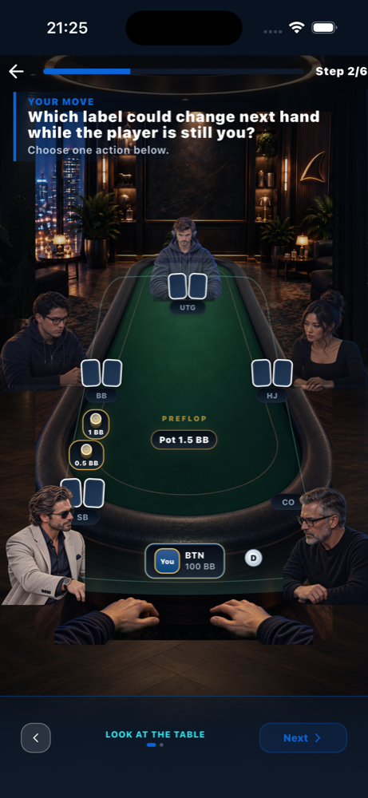 | 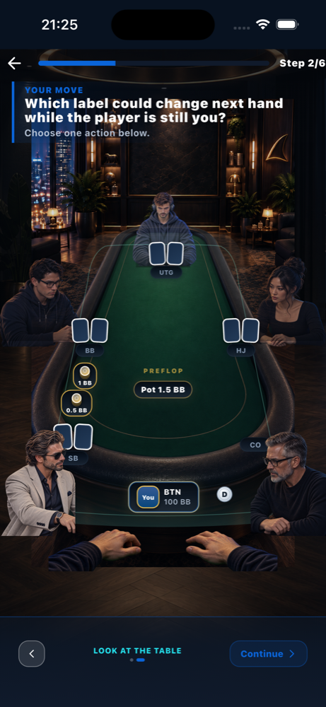 | 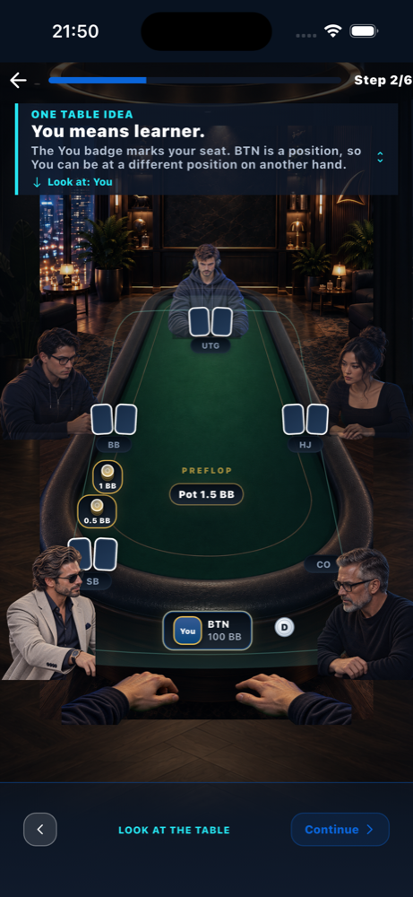 | 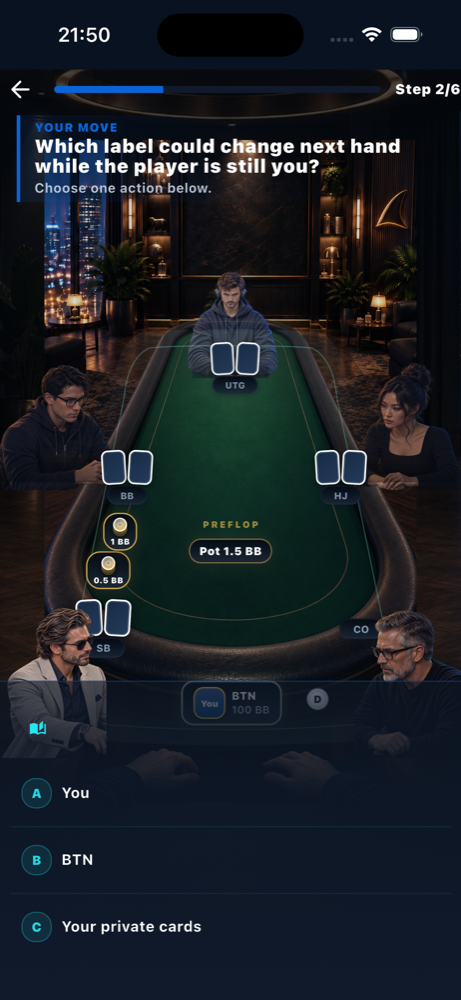 |
| `YOUR MOVE` + future question; authored "You means learner." hidden; "Next" with 2 dots | identical screen, "Continue"; answers only after this | authored title and full body, `Look at: You`, single Continue | genuine decision |

## Route B: `what_poker_is_table_read_transfer` (three-paragraph teaching)

| BEFORE: page 1 of 3 | BEFORE: page 3 of 3 | AFTER: teaching | AFTER: decision | AFTER: feedback |
|---|---|---|---|---|
|  | 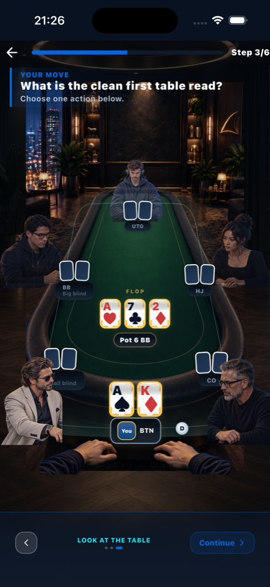 | 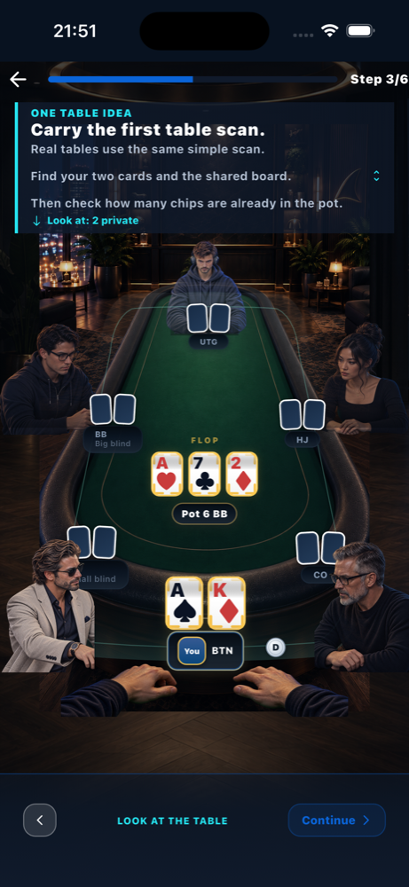 | 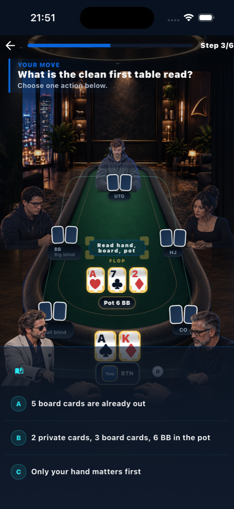 | 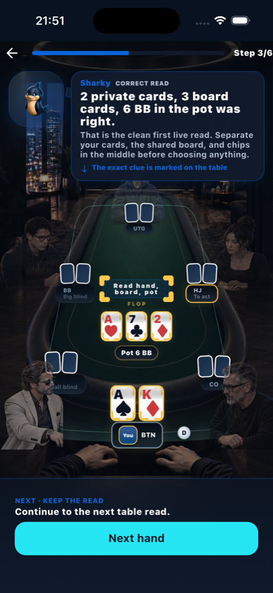 |

## Route C: `actions_raise_drill` (AFTER only)

Reached through the product's own placement result ("Ready for action basics").

| Step 1/2 | Step 2/2 | Decision | Feedback |
|---|---|---|---|
| 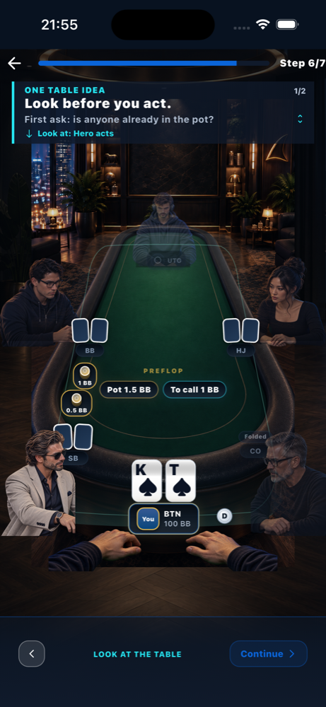 | 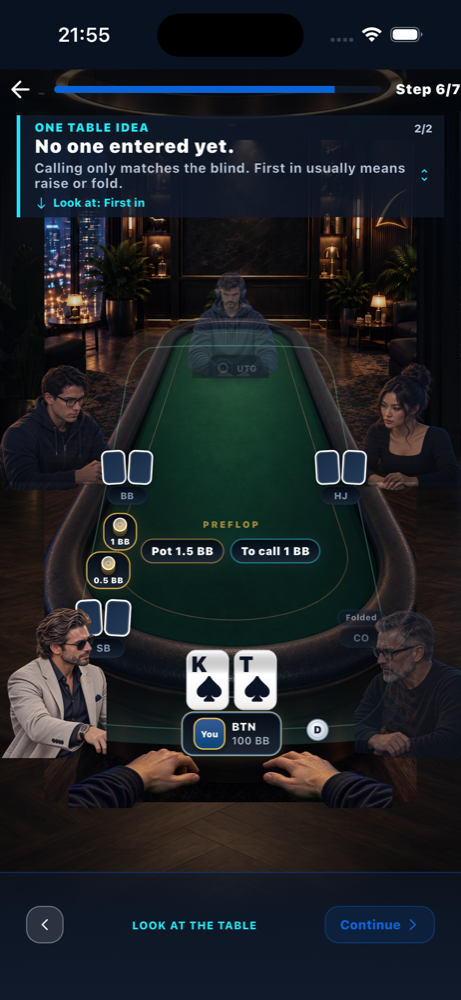 | 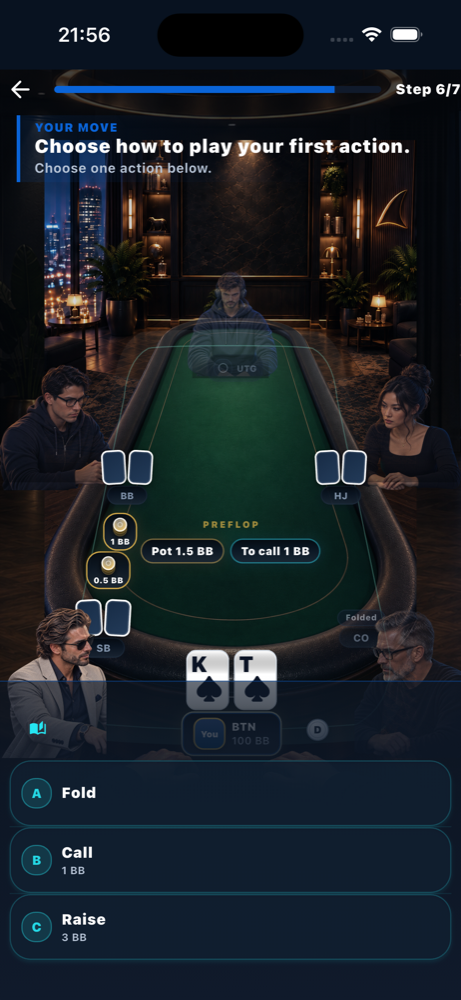 | 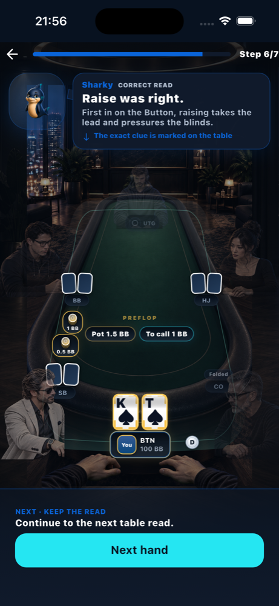 |

## Route D: `what_poker_is_theory` (unaffected control)

| BEFORE | AFTER step 1 | AFTER step 2 |
|---|---|---|
| 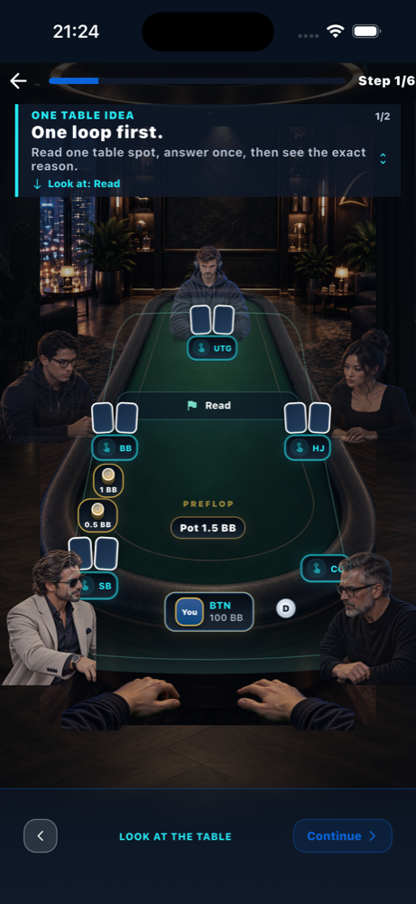 | 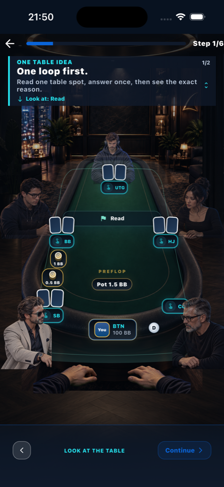 | 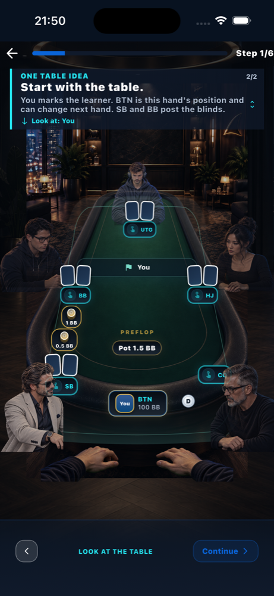 |

## Not proven natively

- **Answer-free recap (`w4_value_recap` and 31 others).** These are World 4+ and need genuine progress, so there are no native screenshots. They are covered by the real preview-flow widget test and the mounted catalog test in PR #332.
- **200% text.** The play surface pins text scaling to 1.0, so iOS text size never reaches the runner. 200% is covered by widget tests only.

## Ledgers

[`teaching_coverage_en_100.csv`](teaching_coverage_en_100.csv) and [`teaching_coverage_en_200.csv`](teaching_coverage_en_200.csv) are the per-step English coverage (687 rows each, all PASS) at `6b1ec9ed`. They were produced by `test/ui_v2/act0_learn_ux_p1_teaching_catalog_coverage_v1_test.dart` with `LEARN_UX_P1_LEDGER_DIR`.
